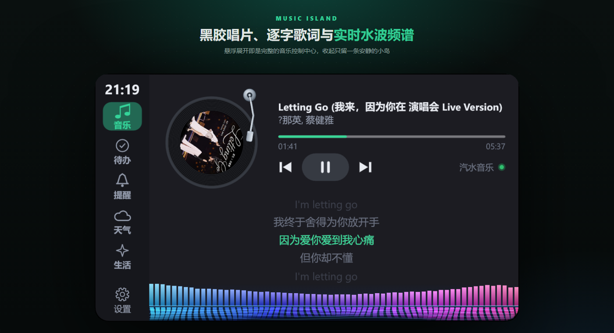
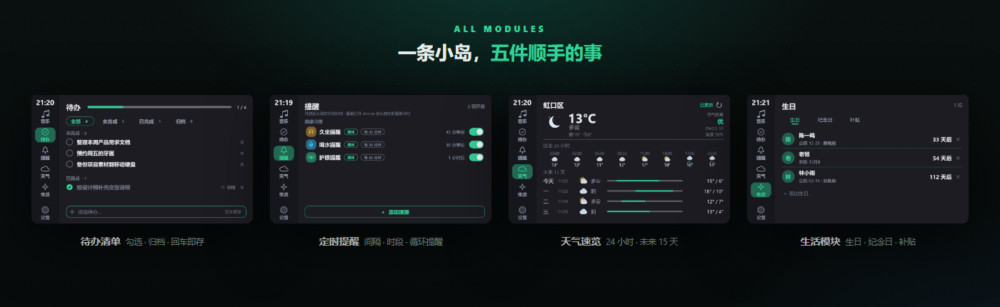

<div align="center">


# WinIsle

**把「灵动岛」带到 Windows 桌面 · 开源 · 轻量 · 原生 Rust**

[](https://github.com/long-mf/WinIsle/releases/latest)
[](LICENSE)


[🌐 官方网站](https://long-mf.github.io/WinIsle/) · [下载安装](https://github.com/long-mf/WinIsle/releases/latest) · [问题反馈](https://github.com/long-mf/WinIsle/issues)

</div>

---

<div align="center">

</div>

## 简介

**WinIsle** 是一个原创开源的 Windows 顶部「灵动岛」桌面伴侣。它常驻屏幕顶部，收起时只是一条精致的小岛；悬浮展开就是一个完整的控制中心——音乐、待办、提醒、天气与生活模块，都在同一条小岛里随手切换。

- **纯原生**：使用 **Rust + egui/eframe 0.31**（glow/OpenGL 后端）从零实现，无 Electron、无 WebView、无运行时依赖，单文件即可运行。
- **轻量安静**：常驻内存占用低，收起态只占一条小岛，不占任务栏、不打断工作。
- **开箱即用**：支持系统媒体控制（Windows SMTC）、网易云 / 汽水音乐实时歌词、逐字卡拉 OK 高亮、毛玻璃展开动画与系统托盘。
- **不止于音乐**：待办清单、定时提醒、天气速览，以及把生日、纪念日与出差补贴装在一起的「生活」模块。

> **官网：** <https://long-mf.github.io/WinIsle/>

## 功能特性

- **黑胶音乐岛** — 三层旋转唱片（外环 / 黑胶音纹 / 真实封面）+ 摆动唱臂，歌名歌手、进度条与上一首 / 播放暂停 / 下一首。
- **逐字渐绿歌词** — 卡拉 OK 式逐字点亮，换行平滑上滚、超长跑马灯；多源歌词（网易云 LRC/YRC、汽水官方逐字）。
- **待办清单** — 岛内快速记录、勾选完成、归档与回车即存，随手把心里的事放下。
- **定时提醒** — 自定义名称、图标、重复间隔与生效时段，到点用系统通知提醒你。
- **天气速览** — 折叠态常显天气，展开查看多日详情；程序化动态天气图标，支持城市搜索与自动定位。
- **生活模块** — 生日倒计时（公历 / 农历双历法、生肖星座）、纪念日（每年 / 一次性、周年），以及出差补贴（按天分档、自动累计总补贴与至今补贴）。
- **收放动画** — 毛玻璃展开 / 收起、松手吸附回弹；左侧模块独立切换，记忆上次停留页面。
- **待机表情** — 无音乐时可选择显示时间，或 14 种带动画的机器人表情（Otto 表情素材）。
- **设置中心** — 歌词 / 显示 / 收起态 / 软件更新等全部在岛内完成，改动即时生效。
- **自动更新** — 每日检查新版本，后台下载进度，一键安装并自动重启。

<div align="center">

<br><sub>一条小岛，五个模块：音乐 · 待办 · 提醒 · 天气 · 生活，随手切换。</sub>
</div>

<div align="center">

<br><sub>生活模块：生日 · 纪念日 · 出差补贴，一个模块装三件事，都在同一条小岛里。</sub>
</div>

## 技术栈

| 层 | 选型 |
| --- | --- |
| 语言 | Rust（stable, x86_64-pc-windows-gnu / MSVC 均可） |
| GUI | [egui](https://github.com/emilk/egui) / [eframe](https://github.com/emilk/egui/tree/master/crates/eframe) 0.31（glow / OpenGL） |
| 窗口 | Win32 / DWM FFI（置顶无边框、逐帧 `SetWindowRgn` 圆角区域、拖动命中） |
| 媒体 | Windows SMTC（`Windows.Media.Control`）+ 本地播放器内存 / CDP 读取 |
| 托盘 | [tray-icon](https://github.com/tauri-apps/tray-icon) |
| 网络 | [ureq](https://github.com/algesten/ureq) + serde_json |
| 图像 | [image](https://github.com/image-rs/image) |
| 生活模块 | 纯手写公历 / 农历换算（1900–2100 农历表）与按天分档补贴计算，无第三方日期库 |

## 下载与安装

前往 **[Releases](https://github.com/long-mf/WinIsle/releases/latest)** 获取：

- `WinIsle-Setup-<ver>.exe` — 安装包（Inno Setup，支持按用户安装 / 开机自启）。
- `WinIsle-<ver>-portable.zip` — 免安装绿色版，解压即用。

系统要求：**Windows 10 / 11 x64**（依赖 SMTC、Win32 与读取播放器进程内存，macOS / Linux 不支持）。

## 从源码构建

```powershell
# 一键：编译 + 停旧进程 + 部署 + 重启
powershell -ExecutionPolicy Bypass -File scripts\build.ps1

# 仅编译
cargo build --release      # 产物：target\release\winisle.exe

# 运行测试
cargo test --release
```

- 工具链：stable-x86_64-pc-windows-gnu（mingw-w64）。`scripts\genv.ps1` 已配好本机工具链与代理处理。
- 打包发布：`scripts\pack.ps1 -Version x.y.z` 生成 `dist\` 下的安装包 / 绿色版 / `latest.json`；打 `v*` tag 即触发 CI 自动发布。

## 目录结构

```
src/
  main.rs        eframe App：窗口 / 动画 / 音乐模块 UI / 设置 / 待机表情
  life.rs        生活模块：生日倒计时 / 纪念日 / 出差补贴（含农历换算与单元测试）
  platform.rs    Win32/DWM FFI、逐帧窗口区域、拖动命中、网易云内存读取
  smtc.rs        Windows SMTC 会话、元数据、播放控制、时间轴
  lyrics.rs      歌词 / 封面：搜索打分、YRC 逐字、LRC 解析、缓存
  update.rs      自动更新（GitHub API 兜底）
  tray.rs        系统托盘
  paths.rs       数据目录（%APPDATA%\WinIsle\data，绿色版沿用 exe 旁 data\）
assets/          应用图标、唱机贴图、表情动画帧
docs/            官方网站（GitHub Pages，源为 /docs）
installer/       Inno Setup 安装脚本
scripts/         构建 / 打包 / 工具脚本
```

## 开源协议

本项目以 **MIT License** 发布，详见 [LICENSE](LICENSE)。

开发中使用的第三方框架与素材均遵循其各自的开源协议，主要包含：

- **egui / eframe** — MIT OR Apache-2.0
- **tray-icon / windows / ureq / image / serde_json / raw-window-handle** — MIT OR Apache-2.0
- **Otto Emoji GIF Component**（待机表情素材，作者 txp666，经 joelbaby/esp32-oled-animated-faces 整理）— MIT

完整的依赖与素材授权清单见 [THIRD_PARTY_NOTICES.md](THIRD_PARTY_NOTICES.md)。分发或二次开发时请一并保留上述版权与许可声明。

## 链接

- 🌐 官网：<https://long-mf.github.io/WinIsle/>
- 💻 仓库：<https://github.com/long-mf/WinIsle>
- 🐞 反馈：<https://github.com/long-mf/WinIsle/issues>

<div align="center"><sub>© 2026 long-mf · WinIsle · 用 Rust 点亮 Windows 顶部的一条小岛</sub></div>
